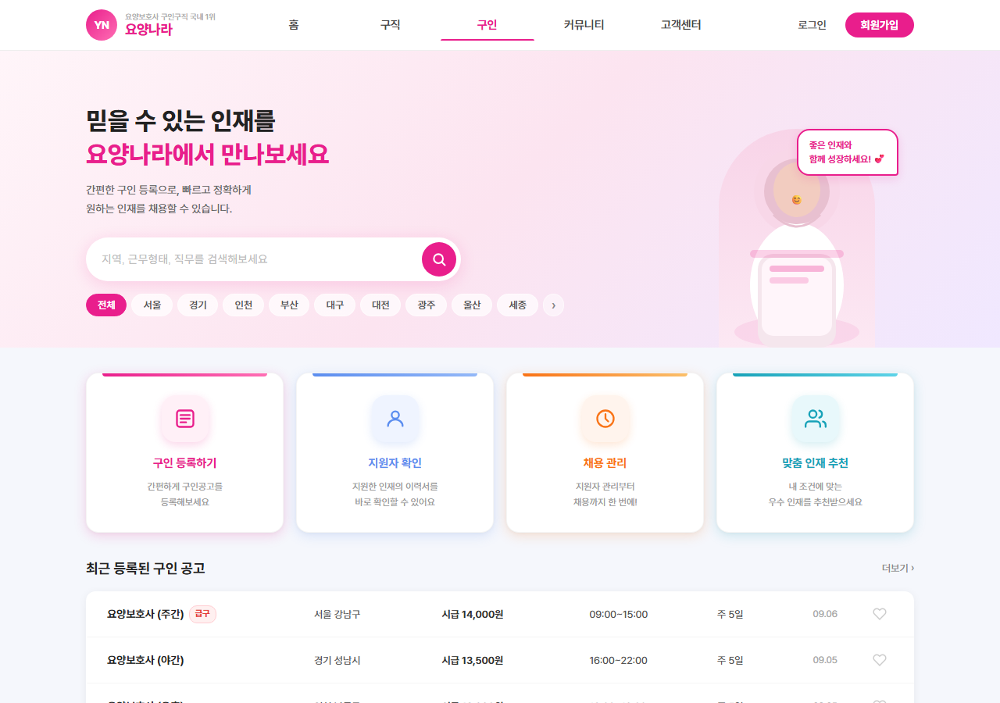
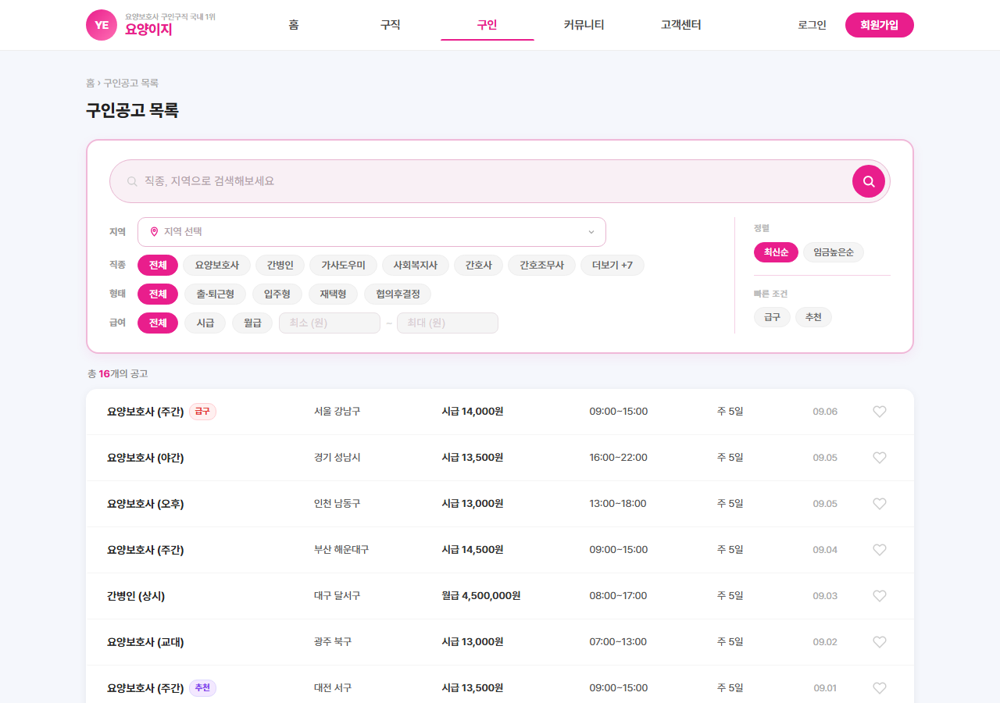
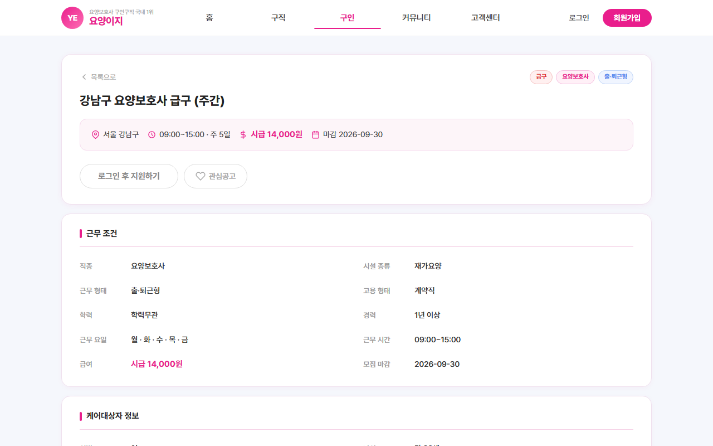
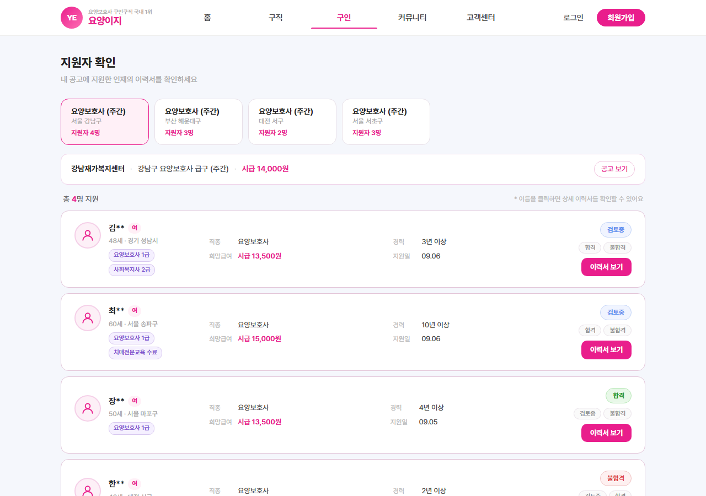
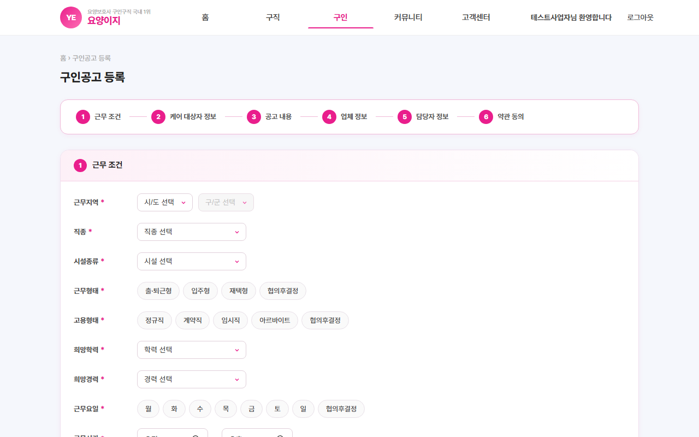
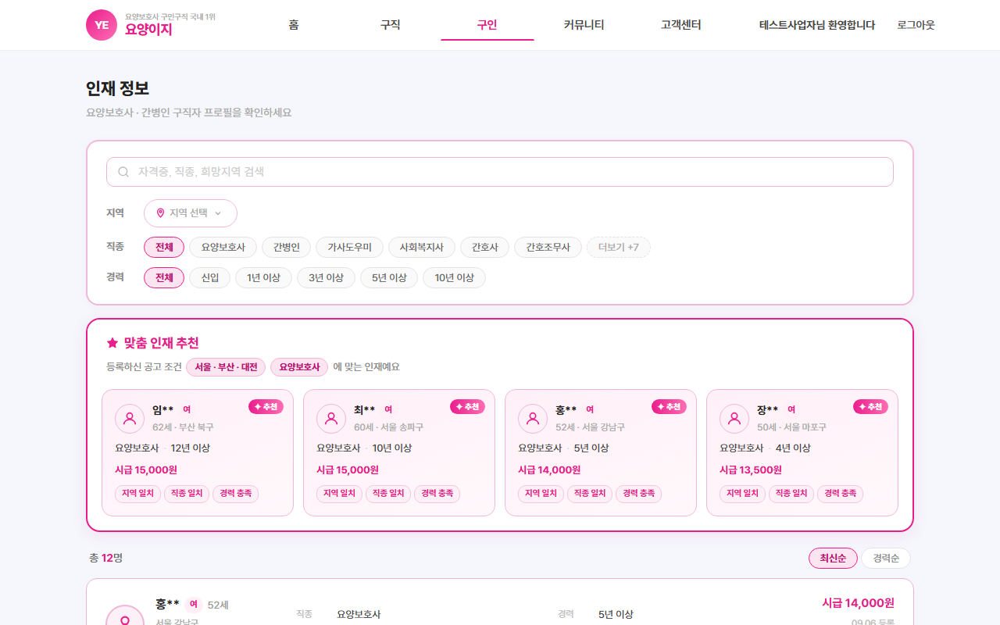

# 요양이지 (Caregiver)

> 요양보호사 구인·구직 매칭 플랫폼 — 기관은 공고를 올리고 지원자를 관리하고, 요양보호사는 지역별 공고를 찾아 지원합니다.



## 주요 기능

| 구직자 (요양보호사) | 사업자 (요양기관) |
|---|---|
| 지역별 구인공고 검색·필터 | 구인공고 등록 (스텝퍼 폼) |
| 공고 상세 보기 / 지원 / 찜 | 내 공고 관리, 지원자 목록 |
| 이력서 등록·수정 | 지원 상태 변경 (검토중/합격/불합격) |
| 내 지원 현황 | 인재 검색·찜 |

- 이메일 로그인 + 카카오/네이버/구글 소셜 로그인 (같은 계정으로 연동)
- 개인 / 사업자 계정 유형 분리, 마이페이지
- 반응형 웹 + Android 앱 (WebView)

| 구인공고 목록 | 공고 상세 | 지원자 관리 |
|---|---|---|
|  |  |  |

| 공고 등록 | 인재 정보 | 모바일 |
|---|---|---|
|  |  |  |

## 기술 스택

- **Backend**: Java 21, Spring Boot 4, Spring Security (세션 + OAuth2), Spring Data JPA, PostgreSQL
- **Frontend**: React 19, React Router 7, Vite
- **Mobile**: Android (Kotlin, WebView)
- **Infra**: GitHub Actions → SSH 배포, Nginx(정적 파일), systemd

```
React (Vite) ──REST──▶ Spring Boot ──JPA──▶ PostgreSQL
                         │
                         └─ OAuth2 (Kakao / Naver / Google)
```

## 내가 맡은 부분

<!-- TODO: 본인이 담당한 기능/기여를 구체적으로 적어주세요 -->
- 
- 

## 팀

5인 팀 프로젝트 · 기여자: R00neyj, kiminwha9465-afk, uiuxzero, woochanhui, teriro

## 로컬 실행

1. PostgreSQL에 `caregiver_db` 생성
2. `src/main/resources/application-secret.properties` 작성 (DB 계정, OAuth client-id/secret — 쓰지 않는 소셜 로그인은 더미 값)
3. 백엔드: `./gradlew bootRun` → `http://localhost:8081`
4. 프론트엔드: `cd frontend && npm install && npm run dev`

## 문서

- [API 및 백엔드 구조](docs/API.md)
- [작업 로그](docs/WORKLOG.md)
